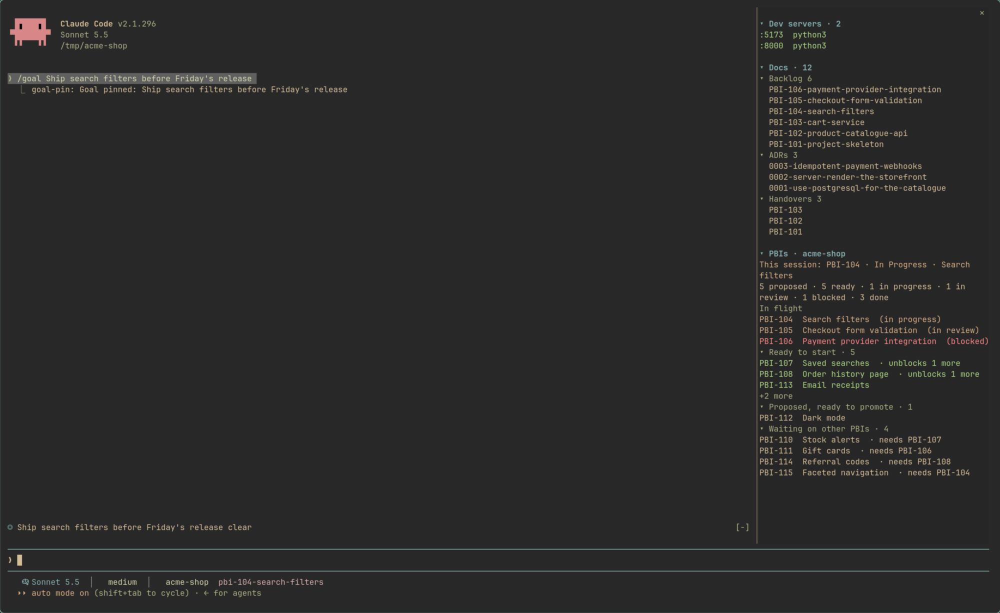

# claude-code-terminal-bar-crawl

Three small additions to the [Claude Code](https://claude.com/claude-code) terminal UI: a bar
at the bottom, a bar at the top and a pane at the side.

| Piece | Where | What it does |
|---|---|---|
| **Status line** | bottom | model, effort, project and branch (with a dirty marker), context use, and 5-hour / 7-day usage with time to reset |
| **`goal-pin`** | top, above the prompt | pins your current goal: `/goal <text>`, or the first real prompt of the session |
| **`project-dashboard`** | side pane | this session's dev servers, the repo's docs, and a PBI board summary; every row is clickable and every heading folds |



*A demo project (Acme Shop, all dummy data). Bottom: the status line. Above the prompt: the goal
pin. Right: the side pane with dev servers, docs and the PBI board. The demo project is
generated by [`docs/demo/make-demo-repo.sh`](docs/demo/make-demo-repo.sh).*

Tested on Arch Linux (Omarchy / Hyprland, Ghostty and foot). It should work on any Linux terminal
that runs Claude Code; see [Requirements](#requirements).

## Install

The two mods install from this repo as a plugin marketplace. In a Claude Code session:

```
/plugin install goal-pin --marketplace jdk-official/claude-code-terminal-bar-crawl
/plugin install project-dashboard --marketplace jdk-official/claude-code-terminal-bar-crawl
```

Answer `y` to add the marketplace, then pick a scope. They are active in that session straight away.

### Status line

The status line is a script, not a mod. Download `statusline/statusline.sh`, make it executable and
point Claude Code at it in `~/.claude/settings.json`:

```json
{
  "statusLine": {
    "type": "command",
    "command": "/path/to/statusline.sh",
    "padding": 1,
    "refreshInterval": 10
  }
}
```

Environment variables, all optional:

| Variable | Effect |
|---|---|
| `CLAUDE_STATUSLINE_ICONS=plain` | ASCII instead of Nerd Font glyphs |
| `CLAUDE_STATUSLINE_PALETTE=/path/colors.toml` | colours from a TOML file of `name = "#rrggbb"` lines (`accent`, `foreground`, `dark_foreground`, `green`, `yellow`, `red`, `magenta`); defaults to the Omarchy theme if present, else built-in colours |

## `goal-pin` (top bar)

```
◎ Add a PBI summary to the dashboard    clear
```

| Command | Effect |
|---|---|
| `/goal <text>` | set the goal |
| `/goal` | show it |
| `/goal clear` | remove it; the first prompt is not taken again |

With no goal set, the first prompt of the session that is a real sentence (not a slash command, not
a one-word reply) is used, shown dim. Per session; hidden while a survey is up.

## `project-dashboard` (side pane)

Open it with `/dash`. Top to bottom:

- **Dev servers**: listening sockets started under this session, or running from inside the repo.
  Other sessions' servers are not shown. Click one to open `http://localhost:<port>`.
- **Docs**: ADRs, handovers and the PBI files (backlog-delivery layout), or `docs/*.md`, or the
  repo's top-level markdown. Click one to open it.
- **PBIs**: for repos that use backlog-delivery style
  boards (`docs/backlog/BOARD.md`, with paths read from `backlog-delivery.config` and an optional
  untracked `backlog-delivery.local.config`): counts per status, what's in flight, what is ready to
  start, what could be promoted, what is waiting on what, and which PBI this session's branch is
  working on. Rows open the PBI's file. The section is absent in repos without a board.

Every heading folds, and the folds persist across sessions. The project is the git root of the
session's directory, or, for a session started elsewhere, the repo of the last file a tool read,
edited or wrote.

### Options

Set under the plugin's settings in `/plugin`:

| Option | Default | Meaning |
|---|---|---|
| `docOpener` | `xdg-open` | command that opens a doc; the path is appended (`code`, your own script, ...) |
| `browserOpener` | `xdg-open` | command that opens a dev server URL |
| `launchPrefix` | *(empty)* | wrapper placed before the opener, e.g. `uwsm-app --` on Omarchy |
| `moveToWorkspace` | `false` | Hyprland only: move the window a doc opens in onto the focused terminal's workspace |

A click never waits on the viewer: openers are launched detached. If one fails you get a toast
with the reason; success is silent.

## What it tells you, and when

The pane keeps quiet unless something needs your attention that you can't already see.

| Event | Shown as | Contains |
|---|---|---|
| A doc or dev server opened | nothing; the window appearing is the signal | |
| An opener failed to launch | a toast, plus a dim line under **Docs** until the next success | `Could not open <name>: <first line of the error>` |
| `/dash` could not draw the pane (narrow terminal, or a surface with no panes) | a toast, and the command's own output | `project-dashboard: pane not drawn, see the summary`, then why, then a plain-text summary of git, PBIs and docs |
| `/goal` | the command's output row | the goal that was set, shown, or cleared |

Toasts use the engine's standard box (top right, a few seconds, click to dismiss). A message is
meant to say *what* failed and *why*; if it can't say why, it says what to run to find out.

## Requirements

- Claude Code with plugin support, on Linux.
- `git`, and `ss` (iproute2) and `setsid` (util-linux) for the dev servers list.
- `jq` for the status line, and for `moveToWorkspace`.
- A Nerd Font for the default status line icons (or set `CLAUDE_STATUSLINE_ICONS=plain`).

## Development

Each mod has tests that run against the engine itself:

```bash
claude plugin validate plugins/project-dashboard
claude plugin test plugins/project-dashboard
claude plugin test plugins/goal-pin
```

## License

[MIT](LICENSE)
